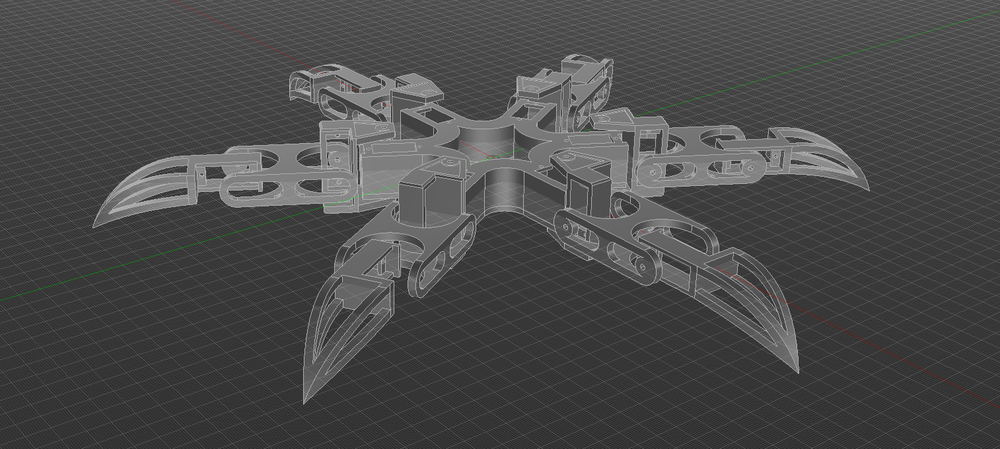
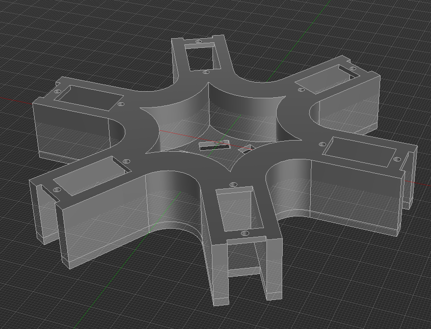
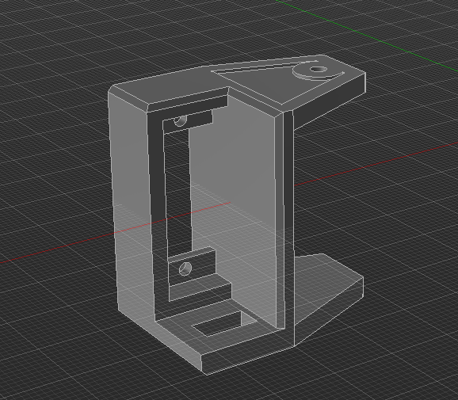
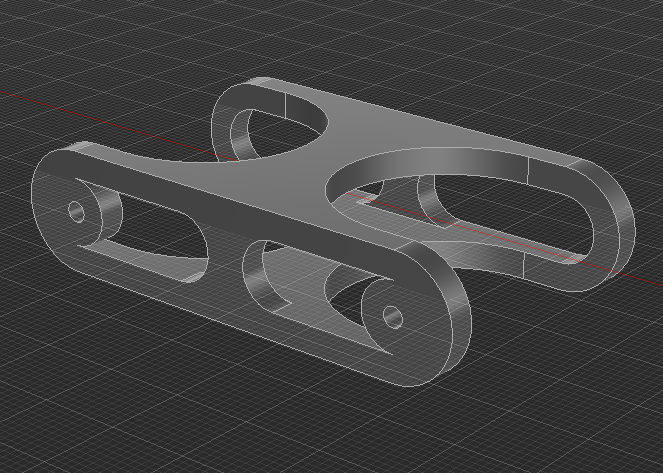
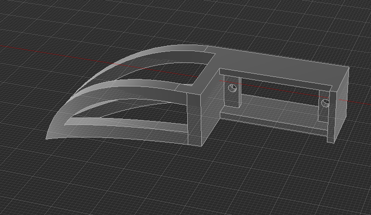

# POD90

**A parametric, customizable hexapod robot designed for 3D printing.**

POD90 is a hexapod robot designed around MG90S servo motors, with a strong emphasis on customization and adaptability. Built in Fusion 360, the model uses user parameters to make modifying dimensions straightforward.

Although the default configuration is designed for MG90S servos, POD90 is not limited to a specific servo model. By adjusting the relevant parameters, the design can be adapted to accommodate different servo motors, heat-set inserts, and other hardware.

The goal is to create a reusable hexapod platform that can be modified to suit different hardware configurations without having to redesign the entire model from scratch.

   

## CAD and Parametric Design

POD90 is designed in Autodesk Fusion using user parameters to control important dimensions throughout the model.

Instead of relying entirely on fixed dimensions, the design allows selected measurements to be changed from Fusion's Change Parameters dialog. This makes it easier to adapt the model to different hardware without manually editing every component.

### Body

   

### Coxa

   

### Femur

   

### Tibia

   

### Customizable Parameters

Depending on the component, parameters can be adjusted for:

- Servo motor dimensions
- Heat-set insert dimensions
- Hardware and mounting clearances
- Other parameterized component dimensions

Changing these parameters updates the associated geometry in the model.

Note: Not every feature is universally parametric. Some geometry may require manual adjustments when adapting the design to significantly different hardware.

### Servo Mounting Holes

The servo mounting holes are currently sized specifically for MG90S servos.

Their geometry has not yet been made universally parametric, so switching to another servo may require manually modifying the mounting holes and their positions.

This is the primary limitation of the current design's hardware adaptability.

## Hardware Customization

POD90 also supports adapting the model to different hardware dimensions, including heat-set inserts.

When changing insert sizes, make sure to verify:

- Insert diameter and length
- Hole diameter and insertion depth
- Surrounding wall thickness
- Screw dimensions and engagement
- Clearances between adjacent components

Always verify the updated geometry against your actual hardware before printing the complete assembly.

## Contributing

Suggestions, improvements, and adaptations are welcome, provided they comply with the project's license.

If you adapt POD90 for a different servo motor or hardware configuration, consider sharing your modifications so other builders can benefit from them.

## Bill Of Materials

|Part|Quantity|Price|Link|
|-|-|-|-|
|MG90s Servo Motor|x18|$2.46 per Servo|https://www.aliexpress.com/item/1005013266086088.html|
|HeatSet Inserts M2xL3xOD3.2|x54|$2.86 for 100 Inserts|https://ar.aliexpress.com/item/1005006838108683.html|
|Screws M2 (6mm)|x54|$1.59 for 50 Screws|https://ar.aliexpress.com/item/1005008709978631.html|
|Raspberry PI Pico|x1|$2.34|https://ar.aliexpress.com/item/1005007393927221.html|
|3D Printed Parts|x20 (Check CAD)|Variable|N/A|

## License

POD90 is licensed under the **Creative Commons Attribution–NonCommercial 4.0 International (CC BY-NC 4.0)** license.

You are free to download, use, modify, and share this design for non-commercial purposes, provided that you give appropriate credit to the original creator, include a link to the license, and indicate any modifications made.

**Commercial use is not permitted without prior written permission from the creator.** This includes selling the original CAD files, modified designs, 3D-printed parts, or kits derived from this project.

This license applies to the original project files and other materials distributed under it, to the extent permitted by applicable law. Third-party components and materials may be subject to their own licenses.

For the complete license terms, see [CC BY-NC 4.0](https://creativecommons.org/licenses/by-nc/4.0/).